# Strike Companion

A free, unofficial editor for the **Alesis Strike / Strike Pro** drum module that runs in your web browser.
It is laid out like the Alesis Strike Editor and adds live MIDI tools, a practice mode, and a **firmware patcher** that builds **Strike MOD FW**, an unofficial firmware mod for the Strike Pro.

**Current release:** Strike Companion **v1.57** · Strike MOD FW **0.9.2-beta**

> **Not affiliated with, endorsed by or supported by Alesis or inMusic.** Alesis and Strike are trademarks of their owners.
> File formats were worked out independently, for compatibility. Use at your own risk and keep backups.

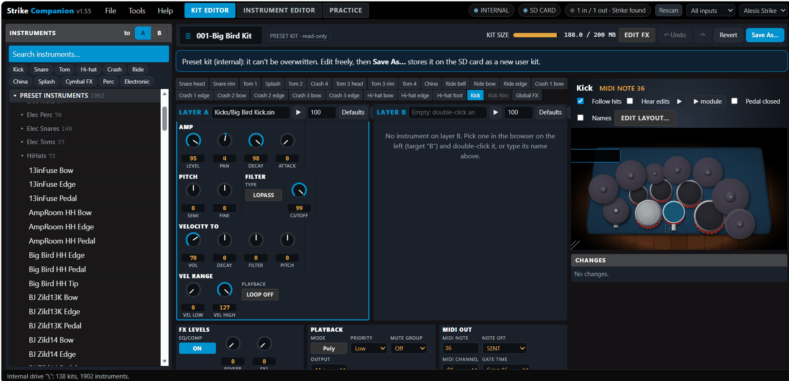

## What it does

- **Kit Editor**: browse preset (internal) and user (SD card) kits, edit every pad: layers A/B, level, pan, decay, pitch, filter, velocity, FX sends, playback, MIDI out. Edit the kit's Reverb, FX1, FX2 and EQ/Compressor.
  Shows the kit's sample-memory size and warns when it goes over the module's 200 MB limit. Clickable kit picture you can arrange to match your own kit.
- **Instrument Editor**: hi-hat pedal positions (Open / Semi-open / Closed) on one draggable bar, velocity ranges, round robin / random, import WAV samples (converted to 48 kHz / 16-bit), Auto-Map by loudness, Quick Instrument.
- **Practice**: play along to a Guitar Pro or MIDI drum score, with hit scoring, looping and a metronome (contributed by Marco Antonini).
- **Live tools**: hi-hat pedal meter (CC 4) with zones, pad hit meters, MIDI log saved in MIDI-OX format, log analysis, and the trigger-settings dump (SysEx 0x0D): receive, edit, save as .syx, send.
- **Firmware patcher** (Tools menu): builds Strike MOD FW from **your own** official Alesis v1.5 update files. See below.
- **Kit Screen Creator** (Tools menu): design the module's kit picture and pad lights for the firmware mod.
- Undo / redo, a list of every change before you save, and backups of files it overwrites.

Preset (internal) content is never written. New and edited kits and instruments are saved to the module's SD card.

## Strike MOD FW (experimental firmware mod)

> **⚠ Experimental beta. Use entirely at your own risk.** Modified firmware is not covered by the Alesis warranty. You can always flash the original v1.5 files back. Minimal testing so far, on one Strike Pro.

Features, each of which can be left out:
- **Hi-hat calibration**: OPEN / CLOSED knobs, RESET key and live pedal meters on the HiHat page, plus hi-hat choke fixes in the trigger chip
- **Pad meters**: CAL (how hard the pad was hit) and OUT (velocity after the curve) on every pad's trigger page
- **Custom kit screen**: your own layout, colours and pad lights from the Kit Screen Creator
- **LOADING box**: shows loaded / total MB until the whole kit is in memory (red until playable, then blue)
- **Faster instrument changes**: no 2-minute full kit reload when sample memory fills up
- **Kick Rim**: the kick jack's ring (K2H) as its own pad
- "MOD 0.9.2 BETA" label on the home screen

Step-by-step instructions: **[User Guide](docs/USER_GUIDE.md)**.

## Pictures

### On the module
| | |
|---|---|
| 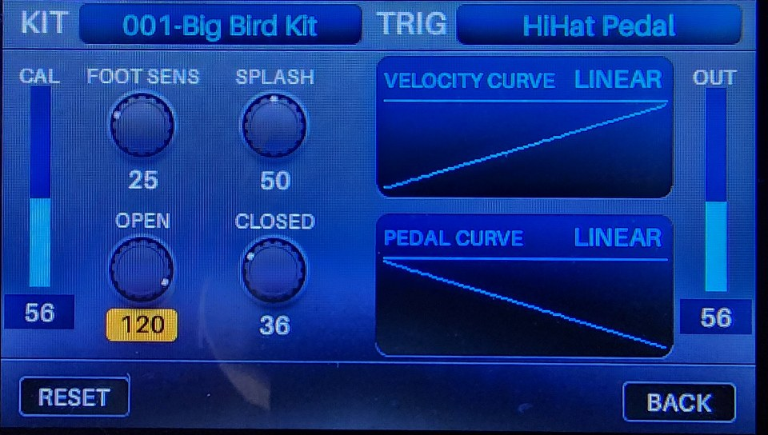 | 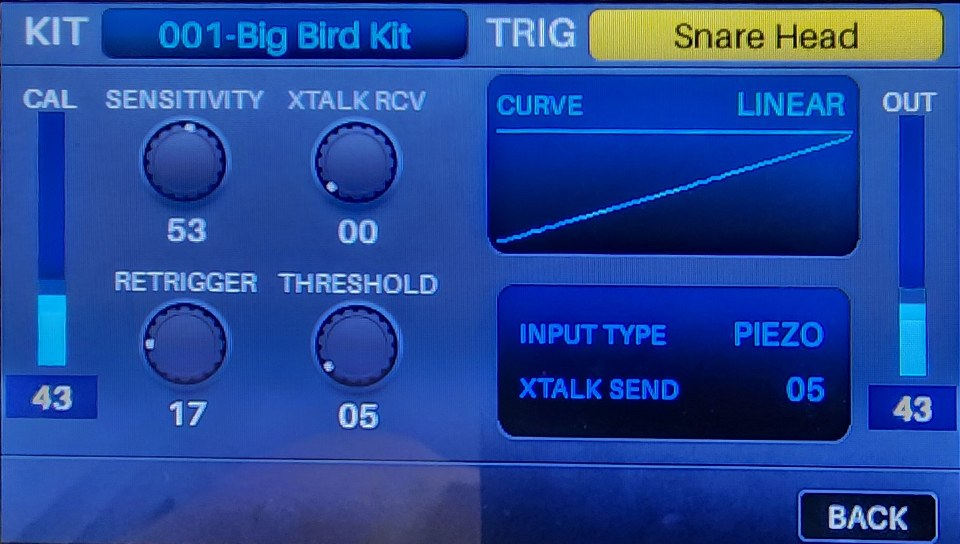 |
| **HiHat page** (photo): OPEN / CLOSED calibration knobs, RESET key and live CAL / OUT pedal meters | **Pad trigger page** (photo): CAL = how hard the pad was hit, OUT = velocity after the curve |
| 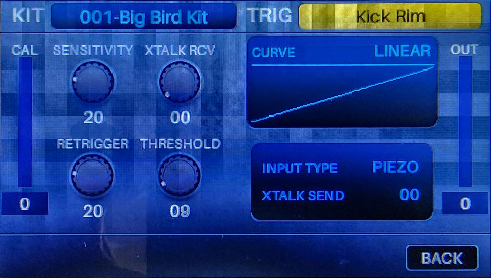 | 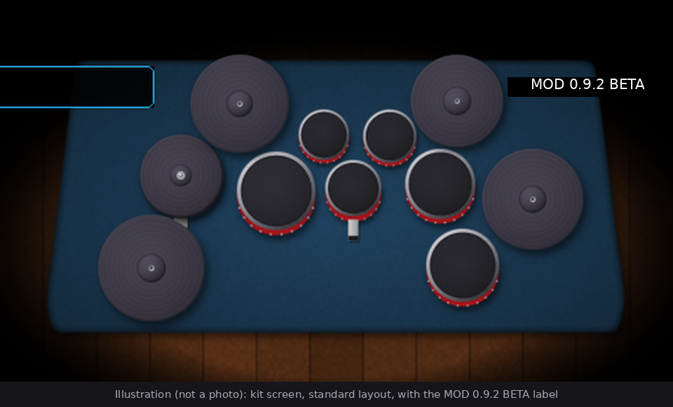 |
| **Kick Rim** (photo): the kick jack's ring as its own pad | **Kit screen** with the MOD label (standard layout) |
| 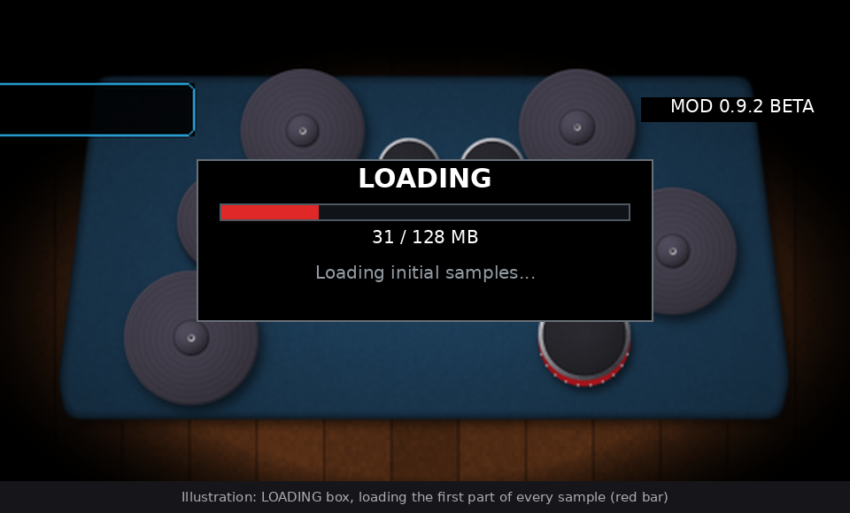 | 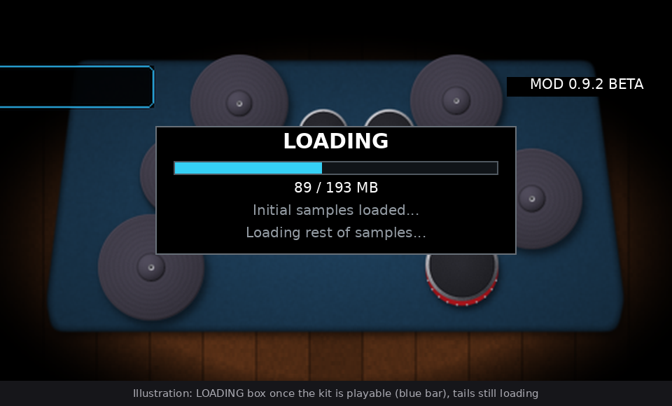 |
| **LOADING box**: red until the kit is playable | **Blue** once soft hits play; the box closes when the whole kit is loaded |

The kit screen and LOADING box pictures are illustrations drawn from the firmware's own layout and colours; the trigger pages are photos of the module.

### Strike Companion
| | |
|---|---|
| 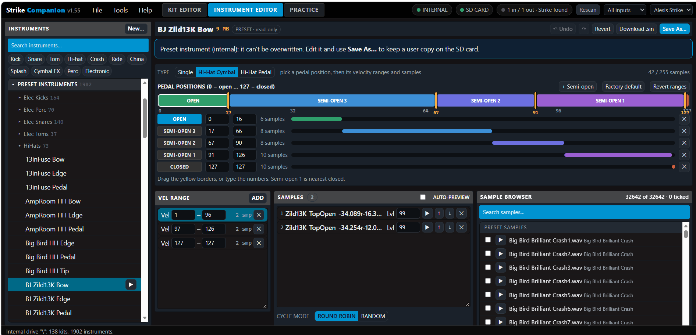 | 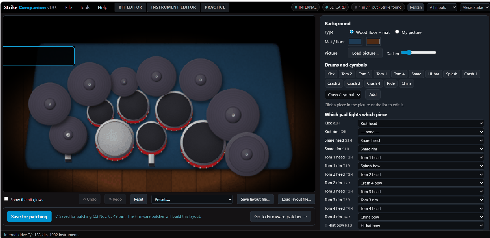 |
| **Instrument Editor**: velocity layers, hi-hat pedal positions and samples | **Kit Screen Creator**: your own layout and pad lights |
| 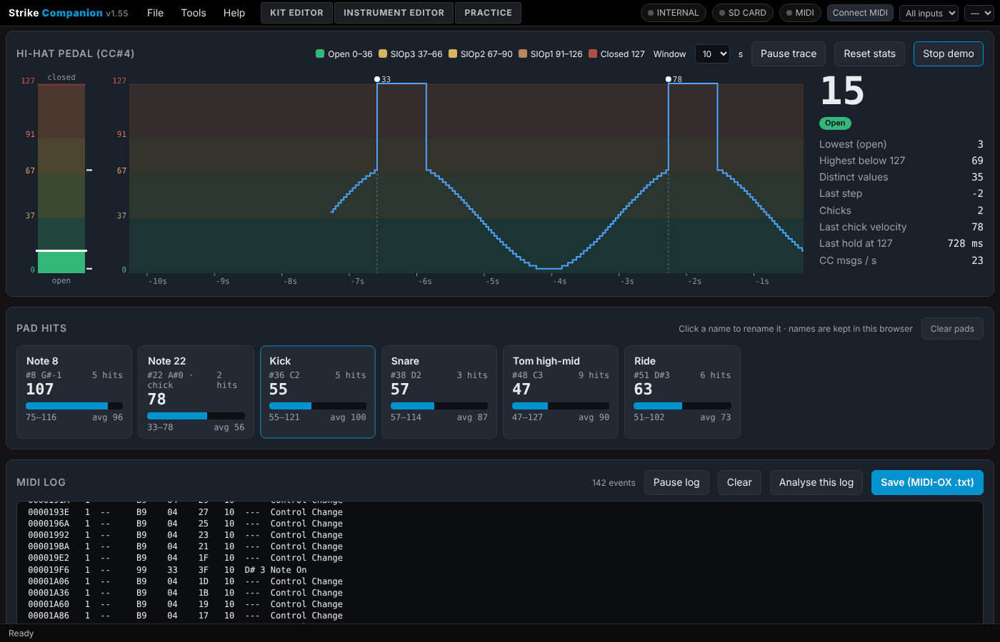 | 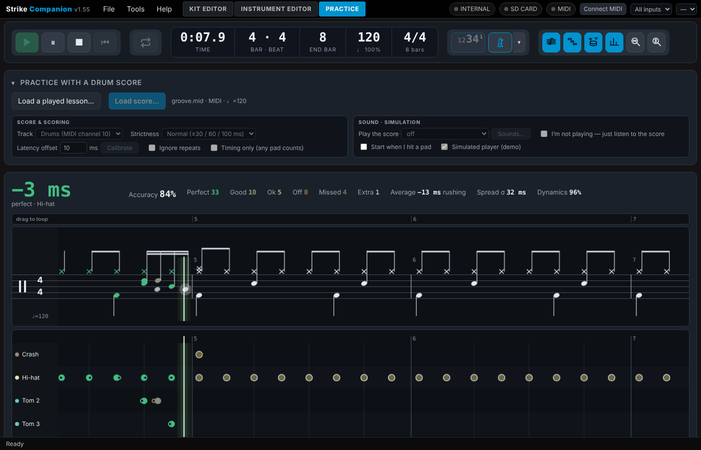 |
| **Live monitor**: hi-hat pedal trace, pad hit meters, MIDI log | **Practice**: play along to a drum score, with timing scores |
| 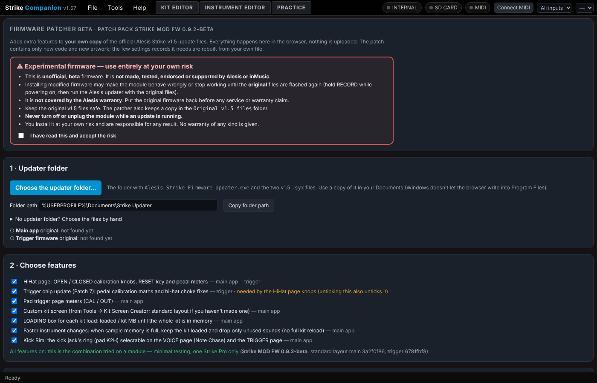 | 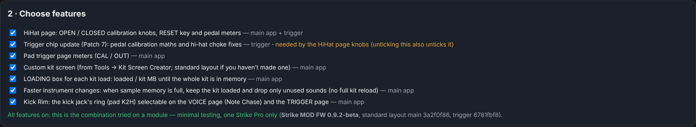 |
| **Firmware patcher**: builds the mod from your own v1.5 files | Choose which features to build in |

## How to use

1. Download `index.html` (or use the GitHub Pages link, if enabled) and open it in **Chrome or Edge** on a computer. Firefox and Safari don't support Web MIDI / folder access.
2. Connect the Strike by USB and switch it on.
3. Click **Connect MIDI** and allow MIDI with SysEx. The page then asks the module to show its internal drive on the computer.
4. **File → Connect Strike drives…** and select the module's drives (internal and SD card). The page remembers them.

No module handy? **File → Open Factory Content Update (.bin)** loads the preset kits and instruments from an official Alesis content-update file, read-only.

For the firmware mod, follow the **[User Guide](docs/USER_GUIDE.md)**.

## Compatibility

| Module | Editor | Firmware mod |
|---|---|---|
| Strike Pro, firmware v1.5 | Yes | Tested on one module (minimal testing) |
| Strike Pro SE | Probably | Probably the same module, not confirmed. Reports welcome. |
| Strike Kit / Strike MultiPad, other firmware versions | Not tested | Not supported |

## Status

Tested against copies of a Strike Pro SD card and the v1.3 factory content update. Features marked as experimental:

- Showing the internal drive over MIDI (uses the same SysEx message as the Strike Editor; not yet confirmed on every setup).
- Curve names marked “?” in Trigger settings are inferred, not confirmed.
- Strike MOD FW is beta firmware.

Please report results and problems in **Issues**. For firmware problems, include the MOD FW and Strike Companion versions, which features you built in and the md5 values shown after the build. Never attach `.syx` firmware files.

## Privacy

Everything runs locally in your browser. Nothing is uploaded. Settings (layout, remembered drives, your saved original firmware files) are kept in your browser's local storage.

## Not included

This repository contains no Alesis firmware, software, samples or content. You need your own module and its files. The firmware patcher adds independently written code and artwork to **your own** official v1.5 files and re-checks every checksum.

## Versions

- **Strike Companion** (the app): v1.57, shown at the top left of the app.
- **Strike MOD FW** (the firmware mod it builds): 0.9.2-beta, shown on the module's home screen; 1.0.0 once it is stable. Based on Alesis firmware v1.5.

See [CHANGELOG.md](CHANGELOG.md).

## Licence

See [LICENSE](LICENSE).
