# Strike MOD FW — User Guide

**Strike MOD FW 0.9.1-beta** · built with **Strike Companion v1.56**

Strike MOD FW is unofficial, community-made firmware for the **Alesis Strike Pro** drum module. It adds features to the official Alesis v1.5 firmware. You build it yourself from your own copy of the official v1.5 update files, in your web browser. Nothing is uploaded anywhere.

> ### ⚠ Use entirely at your own risk
> - This is **unofficial beta** firmware. It is **not made, tested, endorsed or supported by Alesis or inMusic**.
> - Modified firmware may make the module behave wrongly, or stop working until you flash the original files again (see [Going back to stock](#7-going-back-to-stock)).
> - It is **not covered by the Alesis warranty**. Flash the original firmware back before any service or warranty claim.
> - **Never turn off or unplug the module while an update is running.**
> - No warranty of any kind is given. You are responsible for any result.

---

## Contents
1. [What it adds](#1-what-it-adds)
2. [What you need](#2-what-you-need)
3. [Set up the updater folder](#3-set-up-the-updater-folder)
4. [Optional: design your kit screen](#4-optional-design-your-kit-screen)
5. [Build the firmware](#5-build-the-firmware)
6. [Flash the module](#6-flash-the-module)
7. [Going back to stock](#7-going-back-to-stock)
8. [Using the new features](#8-using-the-new-features)
9. [Troubleshooting](#9-troubleshooting)
10. [Known limits](#10-known-limits)
11. [Reporting problems](#11-reporting-problems)

---

## 1. What it adds

| Feature | Where you see it | Firmware part |
|---|---|---|
| **Hi-hat calibration**: OPEN / CLOSED knobs, a RESET key and live pedal meters | Trigger settings → **HiHat** page | main app + trigger |
| **Hi-hat choke fixes** and pedal calibration (Patch 7) | how the hi-hat plays | trigger |
| **Pad meters**: CAL (what the pad sent) and OUT (velocity after the curve) | Trigger settings → each pad's page | main app |
| **Custom kit screen**: your own drum layout, colours and pad lights | home screen | main app |
| **LOADING box**: shows loaded / total MB until the whole kit is in memory | while a kit loads | main app |
| **Kick Rim**: the kick jack's ring (K2H) can be used as its own pad | VOICE page (Note Chase) and TRIGGER page | main app |
| **Faster instrument changes**: when sample memory fills up, the kit stays loaded and only unused sounds are dropped | instrument editor, kit changes | main app |
| **MOD 0.9.1 BETA** label | home screen, top right | main app |

You choose which features to build in. Each one can be left out.

**Tested on:** Alesis Strike Pro module, firmware v1.5 (the latest for all Strike modules).
**Strike Pro Special Edition (SE):** believed to use the same module and firmware, but **not confirmed**. If you try it on an SE, please report the result.
**Strike Kit / Strike MultiPad:** not supported.

---

## 2. What you need

- An Alesis Strike Pro module running firmware **v1.5**.
- A Windows PC with the official **Alesis Strike Firmware Updater** and the v1.5 update files:
  - `Strike updater app version 1.5.syx`
  - `Strike trigger firmware version 1.5.syx`
  (download from the Alesis Strike Pro product page; they come with the updater).
- A USB cable from the module to the PC.
- **Google Chrome** or **Microsoft Edge**. The "put into the updater folder" button needs a Chromium browser. Other browsers can use the **Download** buttons instead.
- `index.html` from this repository. Download it and double-click to open it in Chrome or Edge. It runs offline.

---

## 3. Set up the updater folder

Windows does not let a browser write into `Program Files`, so make a working copy of the updater:

1. Make a folder, for example `Documents\Strike Updater`.
2. Copy `Alesis Strike Firmware Updater.exe` and the two v1.5 `.syx` files into it.

Strike Companion will write the patched files into this folder with the exact names the updater expects. The first time, it also saves the untouched originals in a sub-folder called **`Original v1.5 files`**.

> Keep your own extra copy of the original v1.5 files somewhere safe as well.

---

## 4. Optional: design your kit screen

If you leave this step out, the **standard layout** is used. It has the same pieces in the same places as the stock kit screen.

Open **Tools → Kit Screen Creator**.

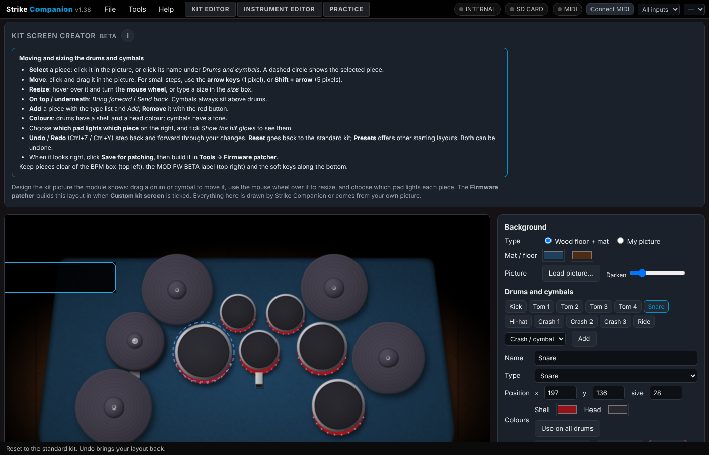

- **Select** a piece by clicking it, or click its name under *Drums and cymbals*.
- **Move** it by dragging. Arrow keys move 1 pixel; Shift + arrow moves 5.
- **Resize** it with the mouse wheel over it, or type a size.
- **Add / remove / change type**: use the type list with **Add**, or the red **Remove**.
- **Colours**: drums have a shell and a head colour (**Use on all drums** copies them). Cymbals have a tone.
- **Background**: the built-in wood floor and mat (choose their colours) or **My picture** with a **Darken** slider.
- **Which pad lights which piece**: on the right, pick the piece and part (head, rim, bow, edge, bell) for each pad. Tick **Show the hit glows** to preview them. Up to 23 glows fit.
- **Undo / Redo**: step back and forward through your changes (Ctrl+Z / Ctrl+Y).
- **Reset**: go back to the standard kit layout. **Presets…** offers other starting layouts, such as *Example: 7 cymbals, tom rims as cymbals*. Both can be undone.
- Click the **i** button for these tips at any time.

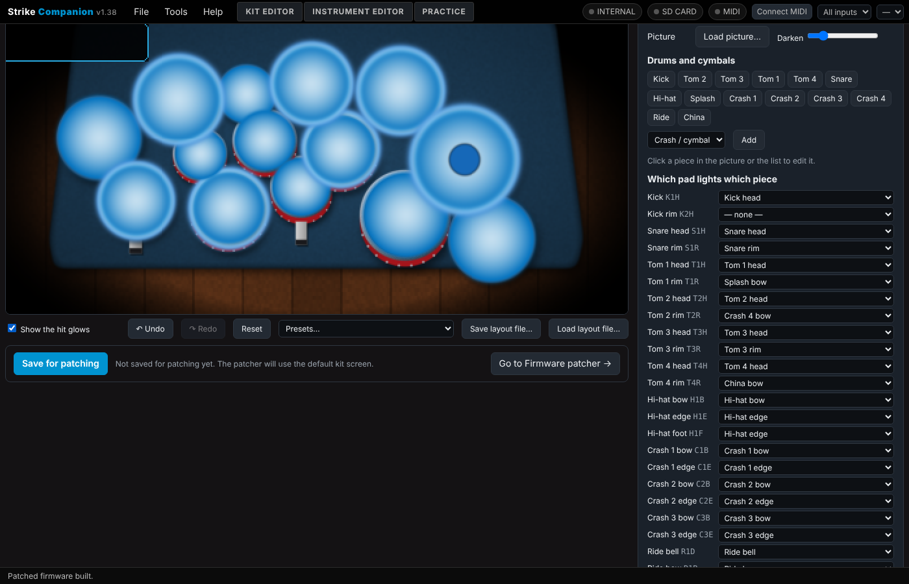

When it looks right, click **Save for patching**. The patcher will then use this layout. **Save layout file…** keeps a copy on disk, so you can share it or load it later.

Keep pieces clear of the BPM box (top left), the MOD FW label (top right) and the soft keys along the bottom.

---

## 5. Build the firmware

Open **Tools → Firmware patcher**.

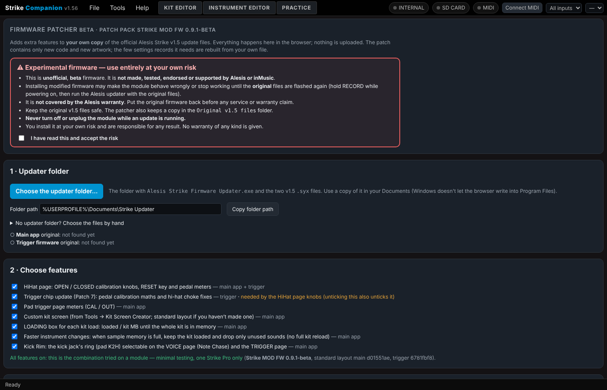

1. Read the warning and tick **I have read this and accept the risk**.
2. **1 · Updater folder**: click **Choose the updater folder…** and select the folder from step 3. Windows will ask to let the page edit files there; allow it. Both originals should show as found.
3. **2 · Choose features**: leave ticked what you want. The **HiHat page** knobs need the **Trigger chip update**, so unticking the trigger update also unticks the HiHat page. The trigger update can be used on its own; the HiHat page knobs can't.

   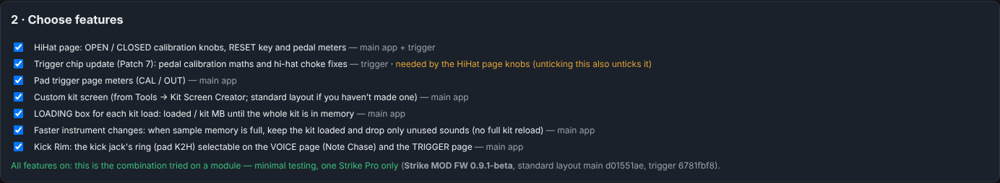

4. **3 · Build and download**: click **Build and put into the updater folder**.

   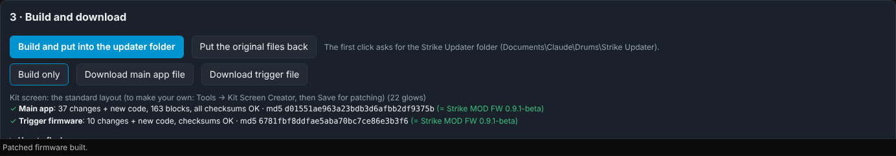

The patcher checks that your files are the genuine v1.5 files. It patches them and re-checks every checksum. It then writes the patched files and offers to open the folder. If anything does not match, nothing is written.

**No updater folder?** Open *No updater folder? Choose the files by hand*, pick the two original files, click **Build only** and then the two **Download** buttons. Put the downloaded files next to the updater with the exact original names. Remove any ` (1)` that the browser added.

---

## 6. Flash the module

1. Turn the module **off**.
2. Hold **RECORD** and turn the module **on**. It starts in update mode.
3. Connect USB to the PC.
4. In the updater folder, run **`Alesis Strike Firmware Updater.exe`** and follow its steps. It flashes both the main app and the trigger firmware.
5. **Do not touch the power or the cable until it says it has finished.**
6. Restart the module. You should see **MOD 0.9.1 BETA** at the top right of the home screen.

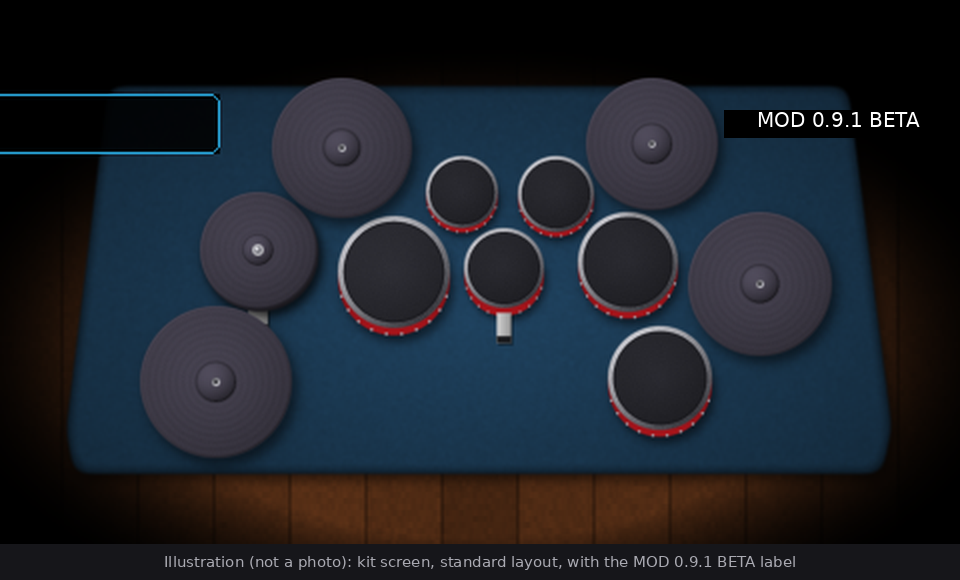

---

## 7. Going back to stock

1. In **Tools → Firmware patcher**, choose the same updater folder and click **Put the original files back**. Or copy the two files from `Original v1.5 files` back over the patched ones yourself.
2. Flash as in [step 6](#6-flash-the-module).

This has been tested: the module returns to the normal Alesis v1.5 firmware. Your kits and samples on the SD card and internal storage are not touched by either update.

---

## 8. Using the new features

### Hi-hat calibration (HiHat page)
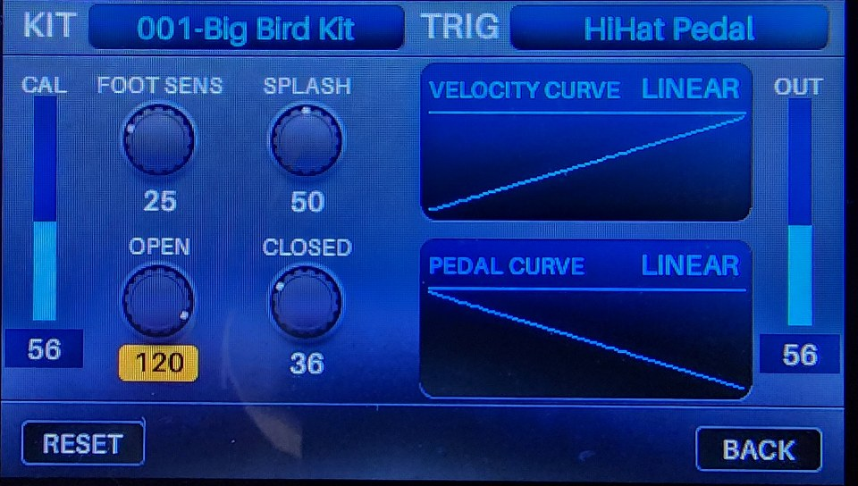

Many Strike hi-hat pedals only use part of the sensor's range. The result is a hi-hat that jumps between open and closed, with little in between. The HiHat page now has **OPEN** and **CLOSED** knobs and a **CAL** meter, which shows the pedal position after calibration.

1. Go to the trigger settings and choose the **HiHat** page.
2. Release the pedal fully. Adjust **OPEN** until the CAL meter just reaches empty.
3. Press the pedal fully closed. Adjust **CLOSED** until the CAL meter just reaches full.
4. Move the pedal slowly. The CAL meter should now travel smoothly across its whole range. (Example from testing: OPEN 121, CLOSED 101.)
5. Press the module's **SAVE** button to keep the settings after power-off.

**RESET** (soft key F1) returns to factory auto-calibration. Press SAVE to keep that too.
The calibration is sent to the trigger chip automatically each time the module starts.
Tip: a pedal curve such as **LOG3** gives more half-open sound.

### Pad meters
Each pad's trigger page shows two meters with peak hold:
- **CAL**: how hard the pad was hit, before the velocity curve.
- **OUT**: the velocity actually sent after the curve.

Use them to set SENSITIVITY, THRESHOLD and CURVE by eye.

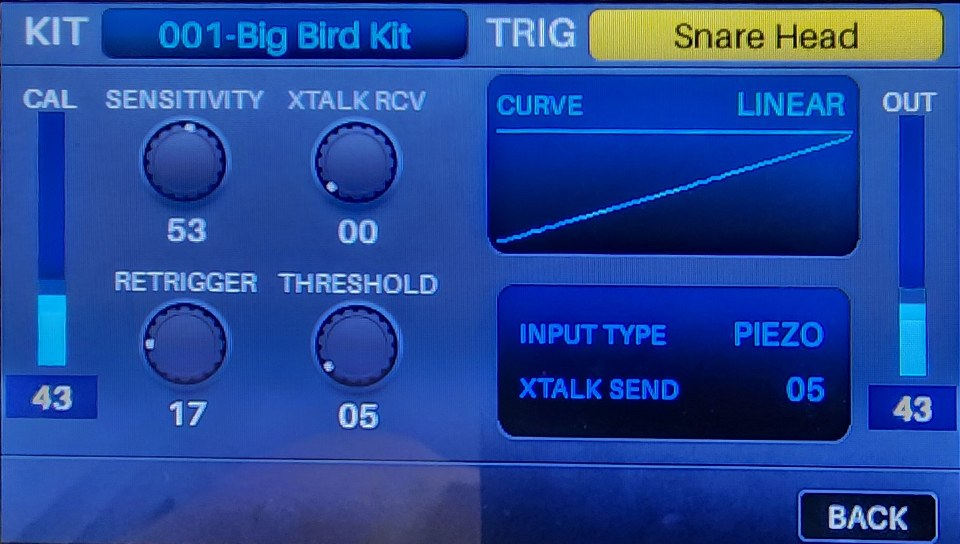

### Custom kit screen
This is the layout you made in the Kit Screen Creator, or the standard layout. Pads light the pieces you chose.

### LOADING box
When you change kits, a box shows how much of the kit is in memory.

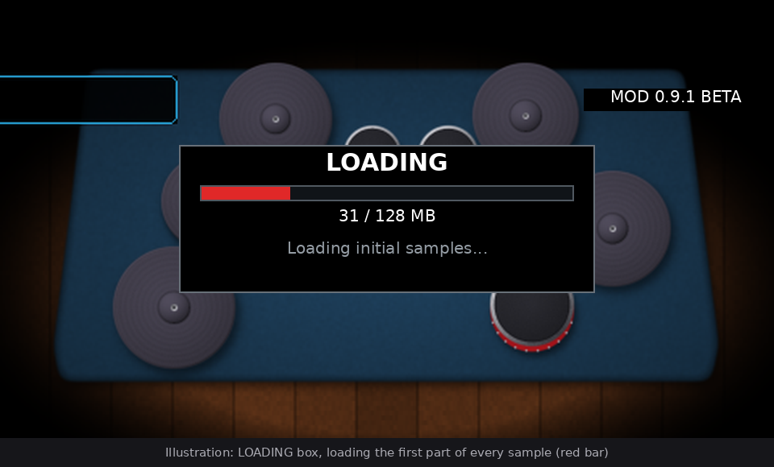
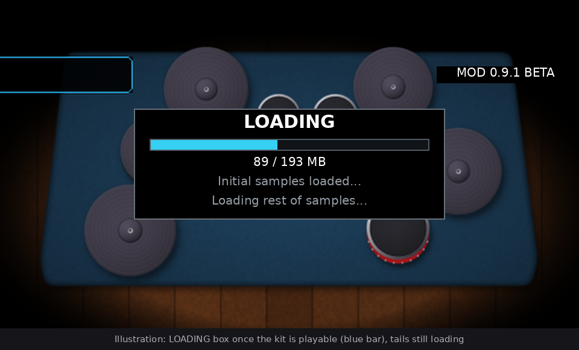

For a large kit on the SD card (around 200 MB), the box goes through these stages. The bar is **red** until the kit is playable, then **blue**:
1. **Preparing kit…** (red): the module opens every sample first. This takes roughly 25–30 s, and the count does not move yet.
2. **Loading initial samples…** (red): the start of every sample is read. Loud hits play first; soft hits may still sound like loud ones.
3. **Initial samples loaded… / Loading rest of samples…** (blue): every velocity layer now plays, including soft hits. The rest of each sound (the tails) keeps loading in the background for roughly 70–80 s more. The box closes when the whole kit is loaded.

Kits on the internal drive load much faster. The SD card speed (about 2 MB/s) is a hardware limit; a faster card does not help.

### Faster instrument changes (memory fix)
The module has 200 MB of sample memory. In the stock firmware every instrument you select (even while just browsing in the instrument editor) is added to memory and nothing is removed. With a big kit, memory fills up after a few changes, and the module then **wipes everything and reloads the whole kit** (up to 2 minutes for a large SD-card kit, with soft hits missing meanwhile).

With this feature the module instead drops only the sounds the kit no longer uses, moves the rest together, and loads just the new instrument. In testing on a 193 MB SD kit, an instrument change was playable again almost straight away (typically well under a second of work; you may hear a short mute while selecting). Switching between two big kits that share sounds is also quicker.

If the kit itself really is bigger than 200 MB, the module still shows "Kit is too large" as before.

### Kick Rim
The kick input's ring (**K2H**) can now be chosen as its own pad on the **VOICE** page (with Note Chase) and on the **TRIGGER** page, for a kick with a rim switch or a second trigger.

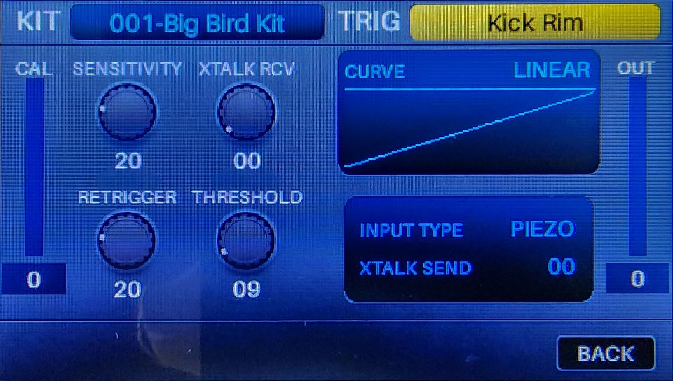

---

## 9. Troubleshooting

| Problem | What to do |
|---|---|
| "Build and put into the updater folder" is greyed out | Tick the risk box and choose the updater folder first. Use Chrome or Edge. |
| It says a file is not the original v1.5 file | Use untouched files from Alesis. If the folder already holds patched files, click **Put the original files back** first. Or use the copies in `Original v1.5 files`. |
| The browser keeps asking for folder access | Allow it. Use a folder in Documents, not Program Files. |
| The updater does not see the module | Start the module holding **RECORD**, then connect USB. Try another USB port or cable. |
| Something behaves strangely after flashing | Go back to stock ([section 7](#7-going-back-to-stock)), then report it ([section 11](#11-reporting-problems)). |
| Hi-hat settings are gone after power-off | Press the module's **SAVE** button after changing them. |
| The kit screen looks like the stock one | You built without saving a layout in the Creator. That is the standard layout. Make one and click **Save for patching**, then rebuild. |

---

## 10. Known limits

- Beta: only one hardware unit tested (Strike Pro, v1.5).
- SD card kits still take as long to load as on stock firmware. The LOADING box only shows the progress.
- Up to 23 hit glows on the kit screen.
- Moving kits to the internal drive for faster loading is planned, but not included yet.

---

## 11. Reporting problems

Open an issue on this GitHub repository. Include:
- the MOD FW version (`0.9.1-beta`) and the Strike Companion version (shown at the top left, e.g. v1.56)
- which features you built in
- the md5 values shown after the build
- your module (Strike Pro / Strike Pro SE) and what happened

Do **not** attach the `.syx` firmware files to issues. They contain Alesis firmware. Each user builds their own from their own official files.
